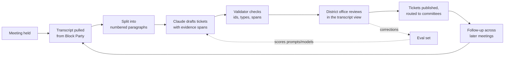
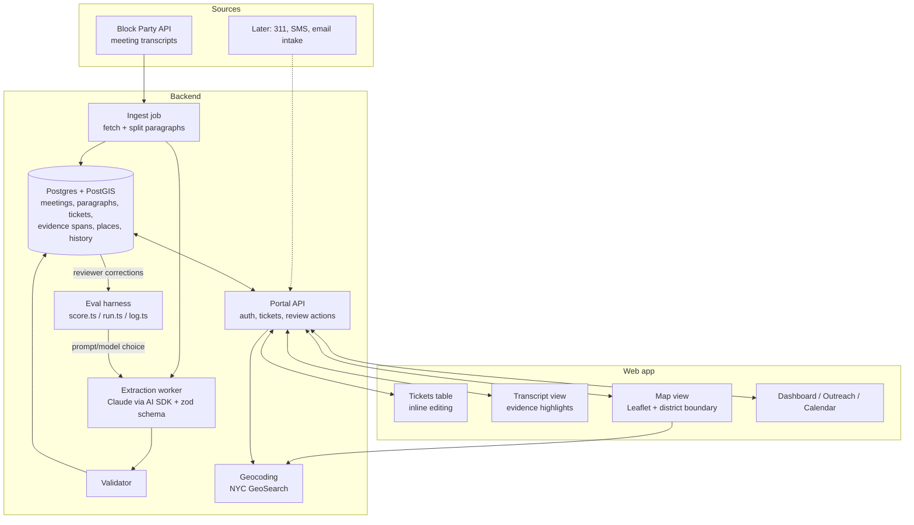
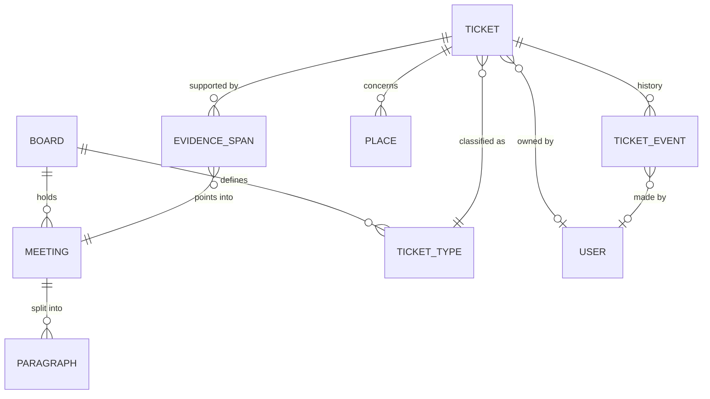

# Loopback Community Board Portal — Ideal State

Loopback turns community board meetings into tracked follow-up work. A meeting transcript goes in; a reviewed list of tickets comes out, each one tied to the exact words in the meeting that support it, to the places it concerns, and to its history across meetings.

This branch (`ideal-state`) describes where the product is headed. The app on this branch is the current prototype for Manhattan Community Board 3 (CB3); the sections below say what it does today and what the full system adds. The `mvp-state` branch is the same prototype cut down to the essential review loop.

## Contents

- [The ideal workflow](#the-ideal-workflow)
- [Architecture](#architecture)
- [Data model](#data-model)
- [Ticket extraction and evaluation](#ticket-extraction-and-evaluation)
- [What exists today](#what-exists-today)
- [Roadmap](#roadmap)
- [Development](#development)
- [Staging](#staging)
- [Engineering practices](#engineering-practices)
- [MIT License](#mit-license)

## The ideal workflow



1. **Ingest.** After each full board or committee meeting, the transcript is pulled from Block Party, which hosts the board's transcriptions, through its API. No one uploads files by hand.
2. **Split.** The transcript is split into numbered paragraphs (`P1`, `P2`, …). Paragraph ids are the stable reference everything else points at.
3. **Draft.** Claude reads the whole meeting and drafts tickets: action items the district office or board must follow up on. Each draft has a title, type (one of the board's ticket types), status, requester, summary ending in an "Action:", the places it concerns, and **evidence**: the paragraphs that support it. Announcements, informational updates with no ask, and procedural filler are excluded; everything about one issue becomes one ticket, even across distant parts of the meeting.
4. **Validate.** Code checks every draft before a person sees it: paragraph ids exist, types are known, every ticket has evidence. Invalid pieces are dropped and logged.
5. **Review.** District office staff review drafts side by side with the transcript. Every ticket's evidence is highlighted in the transcript in its type's color; hovering a highlight lights up its ticket and vice versa. Staff fix fields inline, drag highlight ends to tighten or extend evidence, attach places on the map, merge or split tickets, and reject drafts that are not action items.
6. **Publish and route.** Approved tickets are published and routed by type to the responsible committee or office, with an owner and due date.
7. **Follow up.** When an issue comes up again at a later meeting, the new draft is linked to the existing ticket instead of creating a duplicate. Its status moves from Open to In Progress to Closed, and its history shows every meeting where it was discussed, with evidence from each.
8. **Learn.** Every reviewer correction (an edited type, a moved highlight, a rejected draft) is recorded. Corrections become gold data for the eval harness, so prompt and model changes are measured against what reviewers actually accept.

Around this loop, the same tickets feed the rest of the portal: a map of open issues by place, a dashboard of volume and response times, outreach drafts for resolved wins, and the meeting calendar.

## Architecture



| Piece | Responsibility | Notes |
| --- | --- | --- |
| **Ingest job** | Fetches new meetings from Block Party, splits paragraphs, stores them. | Runs on a schedule or on a Block Party webhook. Idempotent per meeting. |
| **Extraction worker** | Calls Claude with the versioned prompt (`prompts/*.md`), the type definitions, and the numbered transcript; returns structured tickets. | Uses the Vercel AI SDK with a zod schema. Haiku 5.5 is the default model for cost; the eval harness decides when a different model is worth it. |
| **Validator** | Drops unknown paragraph ids, empty evidence, and unknown types. | Same rules as `lib/extract.ts` today. |
| **Portal API** | Auth, roles, ticket CRUD, review actions (approve, reject, merge, split), audit log. | The only place credentials live. The browser never holds API keys. |
| **Database** | Postgres with PostGIS for places. | Evidence is stored as character spans so highlights survive edits. |
| **Geocoding** | NYC GeoSearch for addresses and named places. | Free and keyless; intersections need a fallback geocoder or manual pins. |
| **Web app** | React + Vite + Tailwind. Tickets table, transcript, map, dashboard. | Tables and panels share one ticket store; hover and selection are linked across them. |
| **Eval harness** | Scores model output against gold tickets: matching, P/R/F1, type/status accuracy, evidence overlap, cost. | Gold grows from reviewer corrections. |

### Multi-board

The same deployment serves all 59 NYC community boards. Each board configures its ticket types and definitions, committees and routing rules, district boundary, and Block Party source. Prompts read the board's types and definitions, so extraction adapts without code changes.

## Data model



- **Ticket:** title, type, status (Open / In Progress / Closed), requester, summary, owner, due date, and links to earlier tickets for the same issue.
- **Evidence span:** meeting id + character start/end in that meeting's transcript. The paragraphs a ticket cites are computed from its spans, which is how the table's Transcript column works today.
- **Place:** name, coordinates, and source (geocoder match or placed by hand). A ticket can have several.
- **Ticket event:** every status change, field edit, highlight change, merge, and review decision, with who made it and when. This is the audit trail and the source of eval corrections.

## Ticket extraction and evaluation

The extraction and scoring pieces already exist as scripts and run against the CB3 9/29/26 meeting:

```bash
npx tsx scripts/score.ts --all-annotators          # score the three model annotators vs gold
npx tsx scripts/run.ts --model claude-haiku-5-5 --n 3   # draft tickets with prompts/v1.md
npx tsx scripts/score.ts --run runs/v1-claude-haiku-5-5-1.json
npx tsx scripts/log.ts runs/*.json                 # append scores and cost to results.csv
```

- `lib/extract.ts`: AI SDK `generateObject` call, zod schema, validator, cost per run.
- `lib/score.ts`: greedy one-to-one matching by Jaccard overlap of evidence paragraphs (threshold 0.3), over-split detection, precision/recall/F1, type and status accuracy, and paragraph-level evidence P/R/F1.
- `prompts/v1.md`: the extraction prompt, versioned so prompt changes can be diffed and scored.
- `data/`: transcripts, gold tickets, rejected tickets, annotator tickets, and ticket type definitions.

`run.ts` reads `ANTHROPIC_API_KEY` from `.env.local`, which is git-ignored. On the 9/29 meeting, Haiku 5.5 reaches about 88% ticket F1 for about $0.01 per meeting; status is the weakest field. Status accuracy improves in the ideal state because the extractor sees each issue's history from earlier meetings instead of guessing whether it was "raised before".

## What exists today

| Area | Today (this branch) | Ideal |
| --- | --- | --- |
| Transcript source | `data/raw_train.txt`, bundled at build time | Pulled from the Block Party API per meeting |
| Tickets | The 17 adjudicated gold tickets from `data/`, editable in the table for the session | Drafted by Claude, reviewed, persisted in the database |
| Evidence | Character-span highlights in the transcript; drag the end bars to edit; Transcript column updates | Same, persisted with history, across multiple meetings |
| Places | Seeded places for the gold tickets; add more through NYC GeoSearch; Leaflet map with the CB3 boundary | Same, persisted; fallback geocoding for intersections |
| Review actions | Inline edits | Approve / reject / merge / split, with audit log |
| Status | Set by hand or from gold | Inferred from ticket history across meetings, confirmed by reviewers |
| Other sections | Home, Calendar, Templates, Outreach, Forum, Dashboard use sample data | Backed by the same API and data |
| Auth | None | Roles for residents, board members, and district staff |

Do not enter confidential or personally identifying information into the prototype: nothing is persisted and there is no access control.

## Roadmap

1. **Persist** tickets, spans, and places behind a small API; replace bundled CSVs.
2. **Block Party ingest** with paragraph splitting (`scripts/split_paragraphs.py` is the reference).
3. **Draft review** in the existing table + transcript UI: approve, reject, merge, split; creating and deleting highlights.
4. **Cross-meeting linking** so recurring issues update one ticket and its status.
5. **Corrections to evals**: export reviewer changes as gold; score every prompt/model change before rollout.
6. **Routing and notifications** to committees and owners.
7. **Multi-board configuration** for types, committees, boundaries, and sources.

## Development

Requirements: Node.js 22.12 or later and pnpm 10.

```bash
pnpm install --frozen-lockfile
pnpm dev        # Vite dev server on $PORT (default 8443)
pnpm build      # production build
pnpm preview    # serve the production build
```

Project layout:

```text
.
├── data/                    # transcripts, gold/annotator/rejected tickets, ticket types
├── lib/                     # extraction (AI SDK), loaders, scoring
├── prompts/                 # versioned extraction prompts
├── scripts/                 # run / score / log / split_paragraphs
├── runs/, results.csv       # saved extraction runs and their scores
└── src/
	├── App.tsx              # portal shell, navigation, ticket workspace state
	├── TicketTable.tsx      # editable, resizable tickets table
	├── LocationCell.tsx     # Map column: places + GeoSearch picker
	├── TranscriptView.tsx   # transcript with draggable evidence highlights
	├── MapView.tsx          # Leaflet map, CB3 boundary, ticket pins
	├── goldTickets.ts       # ticket types, demo tickets from data/
	├── transcript.ts        # paragraphs, global offsets, span helpers
	├── geosearch.ts         # NYC GeoSearch client
	└── data/cb3-boundary.geojson
```

Map tiles come from OpenStreetMap's public tile servers, which are fine for a demo; a production deployment should use a keyed tile provider.

## Staging

The `staging` branch is intended for Netlify branch deploys; `main` remains the production branch. In Netlify, enable a branch deploy for `staging` under **Project configuration → Developer settings → Continuous deployment → Branches and deploy contexts**. Pushes to `staging` then deploy to `staging--<site-name>.netlify.app`.

## Engineering practices

- Keep shared records and cross-view state in the owning app/data layer; keep view-only state local.
- Model domain values with explicit TypeScript types and reuse the same records across views.
- Treat transcripts, uploads, and user content as untrusted input. Validate on the server.
- Never put API keys or publishing tokens in frontend source or `VITE_*` variables. Model calls run server-side.
- Version prompts and score every prompt or model change with the eval harness before rollout.
- Preserve accessible names and keyboard operation for icon-only controls, tabs, and table actions.
- After UI or TypeScript changes, run `pnpm build` and check the affected workflow in the browser.

## MIT License

This project is licensed under the MIT License. See the [LICENSE](LICENSE) file for the full license text.
