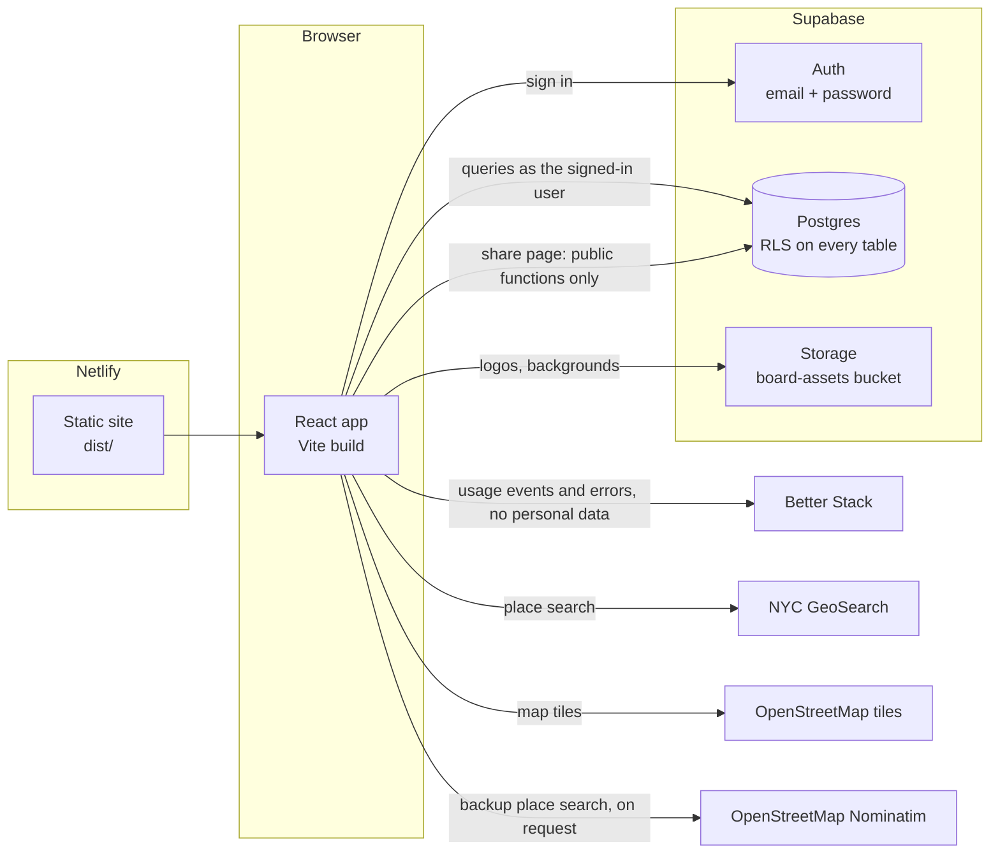

# Architecture

How Loopback works today (V1). Scope, decisions and the version plan are in [`refactor-spec.md`](refactor-spec.md). Where the product is headed (transcripts, AI-drafted tickets, routing) is in [`ideal-state.md`](ideal-state.md).

## Overview



- **One deployment, many boards.** All 59 NYC community boards share one site, one database and one `tickets` table. Nothing board-specific is in the code: name, borough, logo, background, boundary, ticket types and feature flags come from the `boards` row.
- **No server of our own.** The browser talks to Supabase directly with the public (publishable) key. Postgres row-level security (RLS) decides what each request may read or write. There is no API layer to bypass it.
- **Secrets never reach the browser.** `VITE_*` variables are public by design. Anything needing a secret key runs in a Supabase Edge Function: today only `match-transcript`, which holds the Anthropic key.

## Who can do what

| Role | How it is granted | Can do |
| --- | --- | --- |
| **Platform admin** | A row in `platform_admins` | Every board: read, create, edit and delete tickets, replace share links. Switch between all boards in the app. Manage boards, flags and members (SQL today). |
| **Staff** | A row in `board_members` with `role = 'staff'` (legacy `'admin'` counts as staff) | Their own board: read, create, edit and delete tickets, copy or replace the share link. |
| **Public** | Holding a board's share link, `/share/<token>` | One board, read only: number, title, type, status, urgent, deadline, location, submitted date. Never requester, summary, submitted-by, owner, meetings or transcripts. |

The database enforces all of this. The UI only hides what a role can't use.

| Rule | Where it lives |
| --- | --- |
| Read a board's tickets | `tickets` select policy: `is_board_member(board) or is_platform_admin()` |
| Create, edit, delete tickets | `can_edit_board(board)`: platform admin, or staff of that board |
| Read board settings | `boards` select policy: member of that board, or platform admin |
| Change board settings and flags | `boards` update policy: platform admin only |
| Public share page | `public_board(token)` and `public_board_tickets(token)`: `security definer` functions that return only the allowed columns. `anon` has no access to any table. |
| Replace a share link | `rotate_share_token(b)`: checks `can_edit_board(b)` |
| List a board's staff | `board_staff(b)` and `board_staff_named(b)` (adds the name): list a board's staff and emails to that board's staff and platform admins. Not used by the app since the Owner column was removed. |

## Data model

| Table | Purpose | Key columns |
| --- | --- | --- |
| `boards` | One row per community board | `id` (slug such as `m-cb-3`), `name`, `borough`, `logo_url`, `background_url`, `boundary_geojson`, `ticket_types` (`[{label, css_class, definition}]`), `features` (per-board flag overrides), `next_ticket_no`, `share_token` |
| `board_members` | Who is staff on which board | `user_id`, `board_id`, `role` (`staff`, or legacy `admin`) |
| `platform_admins` | Who can manage everything | `user_id` |
| `feature_flags` | Global flag defaults | `key`, `default_enabled`, `requires_board_setup` |
| `tickets` | Every board's tickets | `id`, `board`, `number` (per board), `title`, `type`, `status`, `urgent`, `deadline`, `location_text`, `places`, `requester`, `owner_id`, `summary`, `source`, `submitted_by`, `submitted_at`, `closed_at`, `created_by`, `meeting_ids`, `spans` |
| `meetings` | One row per meeting transcript (V2, transcript matching) | `id`, `board`, `title`, `held_on`, `transcript` (one paragraph per line), `source` (`upload` or `blockparty`), `external_id`, `youtube_id`, `matched_at` |
| `ticket_suggestions` | AI-proposed ticket updates and new tickets from one meeting, and staff's decision on each | `board`, `meeting_id`, `ticket_id` (null for a new ticket until approved), `kind` (`update` or `new`), `evidence` (paragraph ids), `spans`, `changes`, `applied`, `reason`, `status` (`pending`, `approved`, `rejected`), `decided_by`, `decided_at`, `model`, `prompt_version` |

Triggers do the bookkeeping the client must not:

- **Submitted by.** A manual ticket's `submitted_by` is set on insert by the `tickets_submitted_by` trigger to the signed-in user's email; `submitted_at` is the local date it was logged. Updates never send either. Neither is shown in the table.
- **Ticket numbers.** A new ticket is inserted with `number = 0`; the trigger assigns the board's next number under a row lock, so concurrent inserts never collide. The client inserts new tickets and updates existing ones separately; a mixed upsert would renumber.
- **`closed_at`** is set when status becomes `Closed` and cleared when reopened.
- **`created_by`** defaults to the signed-in user.

`meetings` columns map onto Block Party's meetings table (`id` to `external_id`, `cb_id` to `board`, `meeting_youtube_id` to `youtube_id`, `creation_date` to `held_on`, `full_transcript` to `transcript`) so a later sync can fill it. Until then transcripts are loaded by hand with `scripts/load_meetings.mjs`. Board members read a board's meetings and suggestions; only platform admins (and the service role) write meetings or create suggestions. Staff decide suggestions through `apply_ticket_suggestion(s, edited)` and `reject_ticket_suggestion(s)`, which are `security invoker`, so the ticket and suggestion policies apply. Approving an update merges the fields into the ticket and adds the meeting and highlights; approving a new ticket inserts it with `number = 0` and `source = 'transcript'`. Decided suggestions are kept as the audit trail.

Views: `board_effective_features` (each board's resolved flags, read by the app), `board_ticket_metrics` / `board_ticket_counts` (ticket statistics, not used by the app today) and `board_suggestion_stats` (per board and kind: pending, accepted, rejected, accepted %, and how many distinct people reviewed and accepted, from `decided_by`). All are `security_invoker`, so RLS applies.

## Transcript matching (V2, `transcript_matching`)

The Edge Function `supabase/functions/match-transcript` takes a `meeting_id` and the caller's session. With the caller's own client (so RLS applies) it loads the meeting, checks `can_edit_board` and the board's `transcript_matching` flag, and reads the board's ticket types and open tickets. It splits the transcript into paragraphs with the same code the browser uses (`_shared/transcript.ts`), then runs the eval harness's extractor (`_shared/extract.ts`, Claude Haiku 5.5, prompt `evals/prompts/tickets/tickets-v6.md`, which asks for 5 to 10 tickets per meeting). The open tickets go in by number; the model names the ticket an issue is about in `matches_ticket`. A match becomes an `update` suggestion holding only the fields that changed (status, summary, location, requester); anything else becomes a `new` suggestion. A number that is not an open ticket falls back to `new`. Paragraph ids become highlight spans. The function replaces the meeting's pending suggestions with the service role and sets `meetings.matched_at`; decided suggestions are kept.

The prompt ships with the function as `match-transcript/prompt.ts`, generated from `evals/prompts/tickets/tickets-v6.md` by `node scripts/build_match_prompt.mjs` (CI fails if it is stale). Try a prompt change with `pnpm evals:run` before regenerating and deploying.

In the app, with the flag on:

- **Generate**, at the end of the meeting title line in the Transcript tab (right panel, next to Map), runs `match-transcript` on the shown meeting. Running it again replaces that meeting's suggestions still waiting for review. Afterwards the table switches to the Review tab.
- **Review tab**, after All, Urgent and Non-urgent. Each pending suggestion is a greyed-out, read-only row. An update shows in place of its ticket with the proposed values; a new ticket shows at the top, marked New. Changed fields are underlined, and hovering one shows the value before. A row waiting for review also counts under Urgent or Non-urgent. **Reviewed** applies it (`apply_ticket_suggestion`) and the row becomes a normal, editable ticket. **Reject** dismisses it. Staff edit a suggestion by accepting it and then editing the ticket.
- **Transcript column**: one tag per meeting in `meeting_ids`. Clicking a tag opens that transcript, scrolled to the ticket's highlights. On a review row, the meeting the suggestion came from is tinted purple.
- **Transcript tab**: a pending suggestion's paragraphs are underlined, and hovering its row lights them up (they share the row's id, `review-<suggestion id>`). Approved highlights are shaded in the ticket type's colour and can be dragged to tighten them.
- The panel (`src/features/transcript/TranscriptPanel.tsx`), `TranscriptView` and the paragraph code load with `React.lazy`, so they are a separate chunk that boards without the flag never download. `pnpm check:bundle` fails if they reach the entry chunk, or if the CB3 demo data reaches any chunk.
- Transcripts are fetched one meeting at a time when shown. The table only loads meeting titles and dates and the pending suggestions.
- Approving a suggestion on a ticket with unsaved edits is refused until the edits are saved, because the database merges the suggestion into the stored ticket.

## Feature flags

A flag's value for a board is the board's override in `boards.features` if present, otherwise the global `feature_flags.default_enabled`. The app reads resolved values from `board_effective_features` and nowhere else.

| Key | Default | What it controls |
| --- | --- | --- |
| `manual_intake` | on | New ticket button, home "Submit a New Ticket", intake form |
| `district_map` | on | Map panel and rail, map action on home, map on the share page |
| `transcript_matching` | off | V2. Transcript column and tab, AI suggestions to review. Checked again server-side by `match-transcript`. The transcript UI is a lazy chunk; CI keeps it out of the entry chunk (`pnpm check:bundle`) |
| `email_intake` | off | V3 |
| `asset_generation` | off | V3 |
| `data_aggregation` | off | V3 |
| `meeting_minutes` | off | V3. Draft meeting minutes from a processed transcript |
| `meetings_tab` | off (on for `staging`) | V2. Meetings tab: a table of meetings, and per meeting the transcript, its tickets and AI-drafted minutes (`generate-minutes` Edge Function, stored on `meetings`, edited in a Tiptap editor) |

Keys are typed in `src/lib/features.ts`; read them with `useFeature("district_map")`. Flags only hide UI. Anything that costs money or touches secrets must also be checked server-side.

## Frontend

```text
src/
├── main.tsx                 # entry; starts analytics
├── App.tsx                  # auth gate, share-page route, portal shell, ticket workspace state
├── SignIn.tsx               # email + password sign-in (no sign-up: accounts are invite-only)
├── PublicBoard.tsx          # /share/<token>: read-only table and map
├── ShareLink.tsx            # staff dialog: copy or replace the share link
├── TicketTable.tsx          # editable, resizable ticket table: row heights, checkboxes, right-click delete (spec 6.2)
├── IntakeForm.tsx           # ticket form: new ticket (manual_intake) and the expanded row
├── RowHeightMenu.tsx        # toolbar menu for the table's row height
├── MapView.tsx              # Leaflet map, board boundary, ticket pins (district_map)
├── LocationCell.tsx         # places on a ticket + place search (GeoSearch, backup on request)
├── geosearch.ts             # GeoSearch and Nominatim clients, biased to the board's borough
├── db.ts                    # the Supabase client, nothing else
├── lib/
│   ├── board.tsx            # BoardProvider, useBoard, useFeature, useBoardSwitcher, roles
│   ├── features.ts          # FeatureKey: the single list of flag keys
│   ├── useDismiss.ts        # close a menu on outside click or Escape
│   └── analytics.ts         # Better Stack analytics and errors (off unless VITE_BETTERSTACK_TOKEN is set)
├── features/tickets/
│   ├── types.ts             # Ticket, Status, Source, Place
│   ├── rows.ts              # Ticket <-> database row mapping (no database access)
│   └── api.ts               # load, insert, update, delete tickets; board staff
├── features/transcript/     # transcript_matching (V2)
│   ├── types.ts             # MeetingInfo, Suggestion
│   ├── api.ts               # meetings, one transcript, pending suggestions, run matching, approve, reject
│   ├── review.ts            # pending suggestions as greyed-out Review rows (main bundle)
│   └── TranscriptPanel.tsx  # the Transcript tab and the Generate button; lazy-loaded
├── TranscriptView.tsx       # transcript with evidence highlights and drag-to-edit (loaded by TranscriptPanel)
├── transcript.ts            # paragraphs and spans; re-exports supabase/functions/_shared/transcript.ts
├── meetings.ts, goldTickets.ts
│                            # CB3 demo transcripts and gold tickets. Only scripts/make_supabase_seed.mjs imports them.
└── index.css                # Tailwind v4 and all styles; ticket type colors by css_class
```

Flow after sign-in: `App` waits for the Supabase session, then `BoardProvider` loads the user's memberships and platform-admin status, picks a board (last used, else first membership, else first board), loads its row and flags, and only then renders the portal. Switching boards remounts the portal so no state carries over. Ticket edits are saved about 600 ms after typing stops: new tickets are inserted, changed ones updated by id.

## Usage analytics

`src/lib/analytics.ts` loads Better Stack's JS tag only when `VITE_BETTERSTACK_TOKEN` is set (production only on Netlify). It is never loaded on the share page or on any address with a query string or hash: the tag adds the real address to every event it sends (session start, page hidden, memory) and cannot be told not to, and those addresses carry share and auth tokens. The full list of events and fields is in [`telemetry.md`](telemetry.md). It sends:

- Screen views (`page-load`, then `page-change`): `/`, `/tickets`, `/sign-in`. Automatic page views are off; the app sends these itself with a cleaned address. Each view of a board's screen carries `board_id`, so views are attributed to the board shown even after a platform admin switches boards.
- Events: `login`, `ticket_created` (with `form_ms` and `save_ms` timings), `ticket_deleted`, `share_link_copied`, `share_link_replaced`, `board_switched`, and for transcript matching `transcript_opened`, `matching_started`, `matching_run` (counts of updates and new suggestions, `run_in_session`, `duration_ms`), `matching_failed` and `suggestion_reviewed` (one per Reviewed or Reject: `kind` new or update, `outcome` accepted or rejected, `fields_changed`). Each also carries `role`, so accept rates can be split between staff and platform admins. The events can't count people, since they carry no user ids; `board_suggestion_stats` in the database does.
- On every view and event, once known: `board_id` and `role` (set by `setAnalyticsUser` and cleared on the sign-in screen; Better Stack's own `user` call is not used, because it attaches ids and emails).
- Web vitals and frontend errors. Errors go through the Sentry SDK inside the tag; `beforeSend` and `beforeBreadcrumb` clean URLs, drop cookies and headers, and drop click and console breadcrumbs.

It never sends ticket content, names, emails, user ids, query strings, hashes or share tokens.

Most of the tag's features are on by default and can only be switched off in Better Stack (application, Frontend tab). Keep these off, since they would capture ticket content: session replays, console logs, auto-capture of anonymous and identified user events, browser fingerprint. Keep on: frontend errors, web vitals, website analytics. As a backstop, the application's ingestion transformations (VRL) drop autocapture events, console logs and replays and strip the fingerprint, so these are not stored even if a switch is turned back on.

The web events transformation also prepares events for dashboards, which can only filter on fields Better Stack extracts:

- It copies `payload.board_id` to `user.group_id` and `payload.role` to `user.group_name`, Better Stack's built-in group fields. No user id is set, and the browser still never calls `user`. Events received before 2026-11-03 14:00 UTC have neither.
- It sets `environment` from the page address: `development` for localhost, `production` for anything else (deploy previews have no token). The app's `environment` setting only reaches error reports, not web events. Events received before 2026-11-03 14:16 UTC have none.

Dashboards (Better Stack, Telemetry, Metrics): `Loopback usage` shows the app's events, sessions and frontend errors, with board, role and environment filters that each default to `all`. The board filter is a fixed list of board ids, so add new boards to it by hand. The role list (`platform_admin`, `staff`) is fixed too. `Website analytics` and `Web vitals` are Better Stack's built-in dashboards.

## Environments and deploys

| Where | What runs | Configuration |
| --- | --- | --- |
| Local | `pnpm dev` on http://localhost:5173 | `.env.local` (git-ignored): `VITE_SUPABASE_URL`, `VITE_SUPABASE_ANON_KEY`, optional `VITE_BETTERSTACK_TOKEN` |
| Deploy previews | Netlify builds every pull request | Netlify environment variables (no Better Stack token) |
| Production | Netlify builds `main` | Netlify environment variables, including `VITE_BETTERSTACK_TOKEN` |
| Database | Supabase project `enanmsnprjviztiiemtn` | Migrations in `supabase/migrations/`; see [`supabase/README.md`](../supabase/README.md) |

All environments currently use the same Supabase project. A separate staging project is planned (spec section 9, step 9).

To try flagged features before a real board gets them, use the `staging` board ("Staging Board"). It has every feature flag on and copies `b-cb-9`'s borough, boundary and ticket types, because the transcripts in `evals/data/b-cb-9/` are that board's. `supabase/scripts/seed_staging_tickets.sql` gives it about two hand-logged tickets per meeting for transcript matching to work on. It is a normal board row in the same database, created by [`supabase/scripts/create_staging_board.sql`](../supabase/scripts/create_staging_board.sql).

Netlify's build runs `pnpm install --frozen-lockfile --force` before building so a stale dependency cache can't break it, and serves `index.html` for unknown paths so `/share/...` links work.

## External services

| Service | Used for | Notes |
| --- | --- | --- |
| Supabase | Auth, Postgres, Storage | Free plan pauses after about a week of inactivity; the daily keep-alive workflow calls `ping()`. Upgrade before real staff depend on it. Built-in email only reaches the project's team; inviting by email needs custom SMTP. |
| Netlify | Hosting and previews | |
| Better Stack | Usage analytics, web vitals, frontend errors | Sets a first-party `_bs` session cookie. Check whether the boards need a consent banner. Replays and autocapture must stay off (see Usage analytics). |
| NYC GeoSearch | Address and place search | Free, no key. Cannot resolve intersections; staff place those by hand. Misses some addresses (1555 Bedford Avenue, for one). |
| OpenStreetMap Nominatim | Backup place search | Free, no key, data under ODbL (the map already credits OpenStreetMap). Its usage policy allows about one search a second and no search-as-you-type, so it runs only when someone asks: Enter with no matches, or the list's last row. The list doesn't name either source. |
| OpenStreetMap | Map tiles | Public tile servers are fine for light use; switch to a keyed provider for heavy traffic. |
